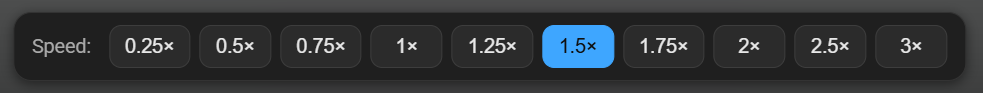

# Video Speed Panel

A row of speed buttons right under YouTube and Udemy videos. One click, and the
video plays at the speed you want — no digging through the settings menu.

## What it does

- **Ten speeds, from 0.25× to 3×.** YouTube's own menu stops at 2×.
- **The current speed is lit up** in blue, so you always see it at a glance.
- **Click the lit-up button to pause.** It turns into ▶; click it again to
  play.
- **Your speed is remembered.** The next video, and the next lesson on Udemy,
  start at the same speed, even after you close the browser.
- **Keyboard shortcuts keep working.** Space, the arrow keys, and the rest still
  control the video after you click a button.
- The panel follows the player when you scroll, resize the window, or switch to
  theater mode, and it matches YouTube's dark look.

It works on YouTube video pages (`youtube.com/watch…`) and on Udemy course
lectures.

## Install

The extension is not in the Chrome Web Store, so it is installed from this page.
It takes about a minute and works in **Google Chrome, Microsoft Edge, Brave,
Opera, Vivaldi**, and other browsers built on Chrome.

1. At the top of this page, click the green **Code** button, then **Download
   ZIP**.
2. Unzip the file into a folder you will keep, such as `Documents\Video Speed
   Panel`. The browser loads the extension from that folder, so do not delete
   it afterwards.
3. Open the extensions page of your browser. Type this in the address bar and
   press Enter:
   - Chrome, Brave, Vivaldi: `chrome://extensions`
   - Edge: `edge://extensions`
   - Opera: `opera://extensions`
4. Turn on **Developer mode**: a switch in the top right corner (in Edge, on the
   left).
5. Click **Load unpacked** and choose the unzipped folder, the one that has
   `manifest.json` in it.
6. Open any YouTube video. The panel appears right under it.

If YouTube was already open, reload its tab once.

> **About the warning:** the browser may say from time to time that developer
> mode extensions are on. That is normal for extensions installed this way;
> click **Keep** or close the message.

## Update

Download the ZIP again, replace the files in your folder with the new ones, then
click the circular **reload** arrow on the extension's card on the extensions
page. Your saved speed stays.

## Remove

On the extensions page, click **Remove** on the **Video Speed Panel** card. You
can then delete its folder.

## Privacy

The extension keeps one thing: the speed you chose, stored in your browser. It
does not collect, send, or share anything, and it has no access to your account,
your history, or other sites. It only runs on YouTube and Udemy pages, and the
only permission it asks for is storage, for that one setting.

All of its code is in this repository, in three small files.

## Questions

**I do not see the panel.**
Reload the page. On YouTube, the panel shows on regular video pages, not on
Shorts, the home page, or videos embedded in other sites. Check also that the
extension is turned on in the extensions page.

**The speed changes back by itself.**
Another speed extension may be fighting with this one; turn the other off.

**Does it work in Firefox or Safari?**
Not at the moment.

**Can I use other speeds, such as 1.1×?**
Not yet; the panel has the ten speeds listed above.
